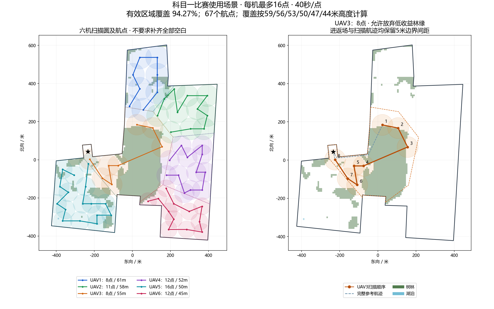

# 科目一比赛使用场景：固定规划

区域采用《周界坐标信息（新增补给区）-0924(3)》科目一/二飞行区域的25个周界点，WGS84。与附件逐点核对一致。仅选 GPS 和操场中央，各档飞行高度均可选。

规划参考点：经度 **113.705630**、纬度 **33.864460**。分区及侦察航点固定在比赛实际经纬度，不跟随任务发布机平移。

## 覆盖与用时

每架最多 **16 个扫描航点**，每点扫描一圈按 **40 秒**估时，航速5米/秒。不再强求全覆盖；优先增加有效覆盖、减少机内及跨机重叠，并缩短航程。表中的半径是扫描覆盖圆半径，不是飞行绕圈半径。

| 无人机 | 参考高度（米） | 覆盖半径（米） | 航点数 | 参考总航程（米） | 参考用时 |
| --- | ---: | ---: | ---: | ---: | --- |
| UAV1 | 59 | 61 | 8 | 1598.2 | 10分39.6秒 |
| UAV2 | 56 | 58 | 11 | 1850.0 | 13分30.0秒 |
| UAV3 | 53 | 55 | 8 | 1191.6 | 9分18.3秒 |
| UAV4 | 50 | 52 | 12 | 1703.5 | 13分40.7秒 |
| UAV5 | 47 | 50 | 16 | 1320.6 | 15分04.1秒 |
| UAV6 | 44 | 45 | 12 | 1691.0 | 13分38.2秒 |

- 从164点减至 **67点**，UAV3从29点减至8点。UAV3取消为填满林缘而专门绕圈的扫描点，参考总航程由1757.1米缩短至1191.6米。
- 任务区域约512330.2平方米，按地图地类扣除树林、湖泊内部后，统计有效面积约433022.6平方米。本方案扫描圆实际并集覆盖约 **408215.6平方米（94.27%）**，允许约24807.0平方米留白。分区仍完整、无重叠地划分整个任务区域；分区完整不表示每一处都被扫描。
- 多机联合计算新增覆盖收益；已有扫描圆覆盖的部分不重复计入收益。约24.72%的有效圆面积计数属于重叠，不宣称零重叠。候选点按5米栅格评估收益，最终覆盖统计用多边形几何并集计算。
- 不添加补齐林缘/边角的航点。候选扫描中心避开免扫描内部和狭窄边带；相邻航点允许穿过树林/湖泊上空的免扫描地类，因为这些地类在现有场景中并非禁飞区。所有航点及直连航段距任务外边界至少5米。
- 离线比较有效固定分区候选及两组航程权重。在覆盖率距候选最大值1个百分点以内时，优先选最长单机用时更短的方案，再比较总用时与重叠面积；未证明全局最优。低收益点不为凑满16点而保留。
- 六机最长参考用时 **15分04.1秒**，参考总航程 **9354.8米**。包含操场中心进场、逐点扫描和返航，不含爬升、下降或临时目标跟踪。实机起降点会改变进返场距离。
- 其他高度档仍然可以选，按用户确认沿用相同航点；上述覆盖率仅对应表中的高度/半径，不推定其他高度具有相同实际覆盖效果。
- 任务参数及网页扫描时间已同步为40秒。本工程不修改程序B；B的实际扫描时长由其自身执行逻辑决定，40秒是本规划的估算依据。

## 起降点与分派

机载竞赛节点在本次开机后、未解锁且 GPS 有效时保存第一次有效坐标，并将该坐标及本次 boot_id 传回地面。通信重连或同次开机重启竞赛节点不改该点；无人机重新开机后重新记录。实际飞机应在最终起降位置上电，随后保持原位直到起飞。

点击规划与分派时取得全部已连接无人机的有效 GPS 和本次开机起降点。六个固定子区域及侦察航点直接从本地读取；进场和返航航线根据各机起降点生成，离任务边界至少5米，并水平避让其他已连接无人机降落点至少2.5米。

若实际起降点太靠近边界、互相过近，或另一降落点的避让区覆盖了必须抵达的航点，分派会明确报错，不会悄悄降低间距。全部参与机航线先校验再发送。2.5米是规划几何间距，不是对实际GPS误差或机间动态避碰的保证。

每机得到自己的进场航线，以及六机全部航点返回该接收机自身降落点的路线。GPS话题中的坐标为“经度、纬度、相对起飞高度”，高度随所选方案。

外部程序B继续使用既有接口：`/ground_mission_planner/vehicle_N/path_stage_1`、`jiangluodian`、`entry_path`、`return_paths`。分派时保存任务，一键起飞到任务高度后发布供B使用。本次不修改外部B程序及原有飞行控制流程；本工程自主控制仍沿用其既有进返场执行逻辑，不能将B的进返场话题视为其已经执行的证据。

## 查看与更新

- 网页选择“科目一比赛使用场景”。主规划图、实时任务详情继续使用本地 Esri 比赛底图，上北下南、左西右东；底图为既有2017年历史影像，不代表最新现场变化。
- [三维规划预览](competition_plans_3d.html?scene=subject1_actual)：选择任意高度和单机，可查看侦察航点、进场及任意航点返航线。离线图共用操场参考点作示意；导入本次实际规划 JSON 后查看各机实际起降点航线。
- 固定规划：`competition_backend/competition_backend/subject1_actual_prepared.json`；边界：同目录 `subject1_actual_area.json`；固定进返场缓存：`external_transit_prepared.json`。
- 本次限点规划更新地面代码及规划文件即可，重启地面后端后重新规划与分派。机载端若已支持开机起降点，无需因本次改动重新编译；仍使用README已有部署指令，不改程序B和目标检测程序。
- 覆盖图重绘：使用含matplotlib的Python运行 `tools/build_subject1_actual_overview.py`。
- 离线重算入口：项目虚拟环境 Python 执行 `tools/prepare_subject1_actual_plan.py`，再执行 `tools/build_plans_3d.py`。日常规划只读取固定扫描结果，不重新运行分区覆盖优化。

本方案已进行离线几何及接口测试；实际地形、障碍物、定位精度和控制跟踪仍需现场核验。
