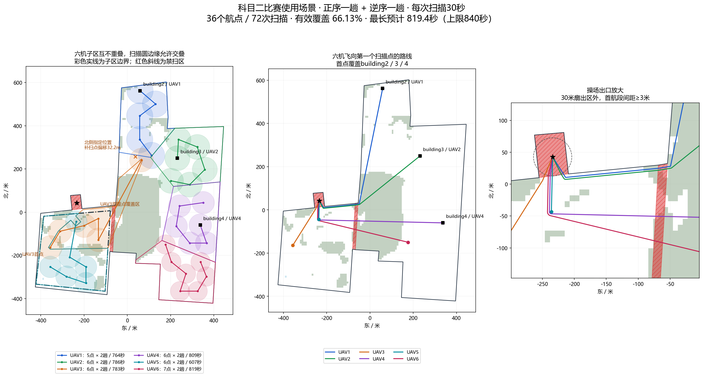

# 科目二比赛使用场景

新增场景标识为 `subject2_actual`，网页名称“科目二比赛使用场景”。本次只增加场景、固定规划及其展示/分派前校验；机载执行器、程序B、起飞、扫描、返航和原场景执行逻辑不变。

## 固定区域和扫描要求

沿用科目一的25个WGS84周界点、操场中央参考起点（纬度33.864460，经度113.705630）、局部北/西坐标投影、森林/湖泊免扫描地类及5米外边界安全距离。只允许GPS和操场中央，区域、分区与扫描航点不会跟随任务发布机位置平移。运行时读取固定方案，不重新优化覆盖。

周界点2、3、4、5围成的区域，以及1、10、11、25围成的区域，为严格禁扫区：每个航点到两块禁扫区的距离不得小于该机侦察半径，因此整个扫描圆不会侵入。它们是禁扫区，不新增禁飞限制；操场起点本身位于其中一块区域，进返场可以通过。森林/湖泊沿用科目一的规则，不在免扫描内部放置扫描点，允许扫描圆边缘顺带覆盖地类边缘。

building2、building3、building4分别归UAV1、UAV2、UAV4，首航点采用相应building的经纬度，因此首点距离为0米。三处建筑到各自子区域边界的距离分别为24.291米、94.897米、79.958米，均大于10米。UAV1、2、4、6保留科目一的分区和本轮调整前的扫描航点；UAV3、UAV5使用下面的共同固定范围，UAV3另外保留用户要求的北侧补扫。扫描允许留白。

### UAV3/UAV5共同固定区域

两机的共同外框采用用户最新给出的四点，下面的顺序为纬度、经度：

1. `33.863902022336234, 113.70398649635622`
2. `33.8610689661699, 113.70360025826871`
3. `33.86077496439185, 113.7070549433847`
4. `33.86413365170231, 113.70731243544304`

四点都在赛方边界内，外框无需外扩。共同范围面积107829.6平方米，其中需侦察面积100673.6平方米。UAV3在原东侧重点区的3个扫描点之外，接手原UAV5的两个点；UAV5从8点减为6点。本次重新划分3/5边界，六机任意两个任务子区均无面积重叠，可以共用分界线。两机子区并集完整包含共同外框，UAV3另含获准的北侧补扫范围；每个扫描航点严格位于本机子区内部。所有航点、顺序、扫描半径和进返场航线均保持上一版不变，因此覆盖率及用时不变。

分区优先保留UAV3扩展范围；为保留UAV5靠北的原航点，在分界处留下与UAV5其余区域连通的凹口，该点距新分界至少15米。两个子区均为单一、连通、无孔洞的多边形，可通过原区域顶点接口表达。扫描圆的边缘仍允许越过任务分界；子区分界不是新增禁飞线，航点间连接线仍沿用原航线。HTML中的橙色虚线仅表示历史重点覆盖范围，不是最终任务子区边界。

UAV3在共同范围内为5个扫描航点，UAV5为6个；两机联合覆盖框内需侦察面积的76.23%。UAV3原重点区覆盖率仍为92.96%。除UAV3的北侧补扫点及其连接航段外，两机扫描航点与扫描航段都在共同外框内。扫描圆按固定半径延伸，仍须完整避开两块严格禁扫区。森林、湖泊免扫描和赛方外边界5米航迹安全距离保持有效。

UAV3首点为自身最南面的航点：纬度`33.862600605591204`、经度`113.70431208229463`。接手的两点分别为此点，以及纬度`33.86327676899837`、经度`113.70479840224931`。

用户指定北侧位置为纬度`33.866391666522034`、经度`113.70856684861998`。精确位置与当前框内航点不能按一条合法直线连接，故在53米邻域内搜索合法点，最终补扫点为纬度`33.866247418328506`、经度`113.7088694477029`，向东南偏移32.25米。55米扫描圆覆盖用户指定位置，且连接航段满足赛方边界5米间距。该点为UAV3第6点，不需要插入额外中转航点；正逆两趟、转折点共60秒均计入预算。若附近没有合法且满足时间预算的候选，离线生成器会跳过补扫，保留框内5点与UAV5的6点。

## 两趟时间预算

按用户确认的程序B行为估算：`1→2→…→N`，然后 `N→…→2→1`，最后从首航点返回自身降落点上方。每次扫描30秒，转折点N执行两次扫描，共60秒。向B仍仅下发单趟航点列表，绝不复制成两趟，也不修改B的执行逻辑。

时间公式为：`高度 / 6 + (进场距离 + 2 × 单趟航点间距离 + 首航点返场距离) / 5 + 航点数 × 2 × 30`，单位秒。14分钟截止到返回降落点上方，不包含下降落地。6m/s爬升、5m/s飞行和30秒扫描是本场景规划估算输入，不修改飞控或B的参数；额外稳定等待、目标跟踪等不在确定性估算内。

| 无人机 | 参考高度/m | 扫描半径/m | 单趟航点数 | 两趟扫描次数 | 两趟总航程/m | 含爬升预计用时 |
| --- | ---: | ---: | ---: | ---: | ---: | --- |
| UAV1 | 59 | 61 | 5 | 10 | 2271.0 | 12分44.0秒 |
| UAV2 | 56 | 58 | 6 | 12 | 2082.9 | 13分05.9秒 |
| UAV3 | 53 | 55 | 6（框内5＋补扫1） | 12 | 2069.1 | 13分02.7秒 |
| UAV4 | 50 | 52 | 6 | 12 | 2200.9 | 13分28.5秒 |
| UAV5 | 47 | 50 | 6 | 12 | 1197.5 | 10分07.3秒 |
| UAV6 | 44 | 45 | 7 | 14 | 1960.5 | 13分39.4秒 |

共36个不同航点、72次扫描。有效区域覆盖率66.13%，覆盖面积283190.7平方米；有效区域面积428207.5平方米。覆盖率按扫描圆并集统计，第二趟重复扫描不会把覆盖率翻倍；不同航点扫描圆的有效面积重复比例10.14%。最长预计819.4秒，距840秒上限尚余20.6秒；UAV3本机距上限尚余57.3秒。

首先复用此前的三组航程权重生成基准方案，再枚举从UAV5移交给UAV3的两个航点及两机的航点顺序。UAV3固定从自身最南航点开始，任意两点间距至少55米。在不改变B接口和逐点扫描方式的前提下，优先保留预算内可直连的北侧附近补扫点，再缩小与指定位置的距离、缩短两机总用时。六机首航段重新联合校验；没有通过14分钟预算的候选不会保存。其他四机的扫描点及子区不变，进场连接线可随六机分离约束调整。未声称全局最优。

## 首航段和实际分派

离线参考方案六机共享操场中心；共有一个起点不可能具有正间距。规划使用30米起飞扇出区，除离线示意共用起点外，六机首航段不允许平面交叉或共线重叠；30米扇出区外的首航段水平间距至少3米。此约束只针对飞向首航点的进场线，不扩展到扫描或返航阶段，也不改变实际避碰控制。

实际分派沿用科目一的本次开机首次有效、未解锁GPS记录，并避让其他降落点至少2.5米。根据已连接机的真实起降点联合重接首航段，逐机重新计算两趟任务时间；候选进场顺序同时考虑不交叉与剩余航程预算。起降位置排列会影响是否能找到14分钟内的方案。任何首航段冲突、边界间距不足或预计用时超过840秒，均在发送第一份任务前拒绝整次分派。最终实际起降点、航线和估时保存在本次任务中并显示在原规划结果/实时详情图。

## 选择场景后实际发布什么

以下针对页面“外部自主程序B”执行模式；选择新场景会选中科目二、GPS、操场中央及59/56/53/50/47/44米高度，不改变执行模式、机载起飞逻辑或程序B。此HTML仅用于离线展示，不发送命令。

### 点击“规划与分派”

页面提交 `/api/v1/plan/jobs`。地面端加载固定航点，用各机本次开机记录的未解锁有效GPS重接进场和返程，检查时间及六机进场分离，然后向启用的机载端分别发送 `assign_task`。任务包含：

- `subject=subject2`、`flight_profile=subject2_actual`、`controller_mode=external`、`coordinate_frame=WGS84`，以及本次 `mission_id` 和完整任务校验和。
- 各机自己的任务边界、单趟扫描航点、半径、30秒扫描动作和目标相对高度。UAV3子区包含接手点及北侧补扫范围；各机单趟点数为5/6/6/6/6/7。
- 自身起降点、飞往首航点的 `entry_path`，以及六机所有36个扫描航点到该接收机自身起降点的 `return_paths`。
- 当前选择的识别类别、既有统一比赛计时状态。外部模式沿用既有规则，不在 `task` 中下发控制速度 `speed_mps`。

机载端校验并落盘后，发布以下ROS数据，地面端等待本次任务ID和校验和相符的回执：

| 话题 | 类型与内容 |
| --- | --- |
| `/ground_mission_planner/vehicle_<L>/task_region` | `String` JSON：闭合任务边界，WGS84，点序为`[经度,纬度]`，任务ID、校验和、相对高度。`polygons[].outer`为外边界顶点，首尾顶点相同；`holes`为孔洞列表，本场景为空。UAV3、UAV5分别发布本次互不重叠的新子区。 |
| `/uav<G>/competition/recognition_categories` | `Int32MultiArray`：页面选中的类别ID；未选择时为空数组。 |
| `/uav<G>/competition/competition_time` | `String` JSON：既有统一比赛计时状态；接受任务不会自动开始这一计时。 |
| `/uav<G>/competition/successful_return` | `String` JSON：既有本机返航状态。 |
| `/uav<G>/competition/task_status` | `String` JSON：`task_received`及当前任务回执信息。 |

此时不发布新的 `path_stage_1`、`entry_path`、`return_paths` 或侦察启动信号，也不触发起飞。已有ROS锁存数据的处理仍遵循原程序行为。

`task_region`是既有接口，机载接收并校验任务后、确认回执前发布，每机话题携带自己的子区。地面分派载荷中的`task.task_region`、机载发给B的JSON边界和三维HTML中的任务子区保持一致。本次只更新边界数据，没有新增或删减接口，也没有调整发布时机和消息结构。

### 点击“一键起飞”并完成原有确认

原有流程先调用 `/api/v1/takeoff/prepare` 预检；确认后调用 `/api/v1/takeoff/confirm`。地面端向启用的机载端发送 `takeoff`，包含本次任务ID、各机目标高度、`deadline_at`、返航电量阈值。

每架机仍由原机载执行器完成起飞；该机起飞成功后，按下表顺序发布给B。起飞失败不会发布本次航点和启动信号。

| 顺序 | 话题 | 类型与内容 |
| ---: | --- | --- |
| 1 | `/ground_mission_planner/vehicle_<L>/entry_path` | `String` JSON：该机自身起点到首扫描点的折线路径，含任务ID与校验和。 |
| 2 | `/ground_mission_planner/vehicle_<L>/return_paths` | `String` JSON：全部36个扫描点到该机自身起降点的返程路径，按源无人机和航点编号索引。 |
| 3 | `/ground_mission_planner/vehicle_<L>/path_stage_1` | `Float64MultiArray`：仅一份正序扫描列表，展开为`[经度1,纬度1,相对高度,经度2,纬度2,相对高度,…]`。 |
| 4 | `/ground_mission_planner/vehicle_<L>/jiangluodian` | `Float64MultiArray`：`[本机降落点经度,本机降落点纬度,本机目标相对高度]`。 |
| 5 | `/uav<L>/competition/external_mission` | `String` JSON：任务ID、校验和、场景、WGS84航点、相对高度、`hover_scan_seconds=30`及每点30秒动作、返场点、原截止时间与电量阈值。 |
| 6 | `/ground_mission_planner/recon_start_mode` | `Int32`，数值`0`，沿用原来的程序B侦察启动方式。 |

上表路径JSON中的路径点同样为`[经度,纬度,相对高度]`。`G`是全局无人机编号，`L`是本机ROS编号；沿用现有绑定（例如SU17可使用本机编号1，P600通常与全局编号一致），配置覆盖话题名时以配置为准。分派、起飞命令经过现有TCP/ROS适配器；ROS适配器对应 `/uav<G>/competition/high_level_command`。

程序B收到的列表没有复制为两趟。按已确认的B行为，UAV3执行 `1→2→3→4→5→6→6→5→4→3→2→1`，每次扫描30秒，然后从1返场；其他飞机同理。新场景不增加第二个启动信号，不改变B的扫描、返航或落地流程。

### 14分钟预算与原执行配置的区别

840秒用于本场景规划及分派前校验，按6m/s爬升、5m/s水平飞行、两趟扫描30秒计算。它不改写实际飞控/B速度，也没有新增“840秒强制返航”控制。

现有 `takeoff.deadline_at` 仍为起飞确认时间加页面比赛时限；未填写时使用原科目配置（仓库示例配置为1140秒，即19分钟）。`external_mission.speed_mps` 沿用机载 `search_speed` 的现有回退值，不是本场景的5m/s估时参数；`path_stage_1`本身只传经纬度和高度。实际速度、两趟扫描和30秒停留由现有飞控及程序B执行。因此代码链路验证通过不等于实飞时间已经验证。

## 接口与改动范围核对

相对新增科目二前保存在 `ground_runtime/subject2_change_backup` 的文件，`api.py` 的49个HTTP路由声明完全一致，没有新增或删除HTTP接口。机载源文件、TCP/ROS适配器、任务协议和程序B未因新增场景修改，因此话题名、消息类型、原控制字段和发布顺序保持原样。

既有 `flight_profile` 增加取值 `subject2_actual`；该场景的任务和预览数据增加了两趟扫描、估时、禁扫区、重点区、共同范围等规划信息，例如 `task.scan_passes`、`task.scan_execution_order`、`task.mission_time_limit_s`。这是同一任务载荷内的场景数据扩展，不是新的控制命令。不会要求B识别一种新消息或额外启动流程。

不能将本次修改描述为“只新增一个JSON、其他文件完全没动”。实际范围为：

| 范围 | 改动 |
| --- | --- |
| 新场景模块与固定数据 | 新增 `subject2_actual_scene.py`、`subject2_budgeted_coverage.py`、`subject2_entry_routes.py`、`subject2_rebalance.py`、`subject2_actual_prepared.json`；移交两点与北侧补扫只在科目二离线生成过程中执行。 |
| `api.py` | 接受新场景值、加载固定规划、强制本场景GPS和操场参考点、设置扫描参数并计算预览估时。 |
| `orchestrator.py` | 新场景默认高度、实际起降点重接、仅科目二分派前的进场分离和840秒预算校验。AST比较仅 `_altitude_profile_for` 与 `plan` 有变化，起飞、返航、状态推进等原方法没有变化。 |
| `transit_routes.py`及缓存 | 注册科目二场景，接入已有起降点避让算法和该场景进场路线。原15份场景缓存内容不变，只新增科目二项及总校验和。 |
| 地面网页与三维HTML | 增加场景选项、默认值、禁扫区/重点区/共同外框、两趟估时显示；更新三维报告生成器及覆盖图。 |
| 测试、文档、离线工具 | 新增场景和六机模拟分派测试，补充原测试对新场景的覆盖，增加离线生成脚本、说明、消息示例及本地验证记录。 |

没有修改科目一固定航点与其他场景的规划数据，也没有修改机载起飞、B的扫描和返航执行程序、通信协议或飞控速度配置。没有向真实无人机发命令。

## 可查看的消息实例

[UAV3完整离线消息示例](subject2_message_example_uav3.json)来自调整后方案的六机模拟测试，包含完整 `assign_task`、任务区域、识别类别、`takeoff` 和起飞成功后6条B消息。示例使用P600、本机ROS编号3、模拟起降GPS；所有任务编号与时间都属于该次离线测试。String话题内容在文件中解析为对象，线上仍是JSON字符串。

该示例的 `path_stage_1` 是6个点的18个数字，按经度、纬度、相对高度排列；`assign_task.task.waypoints_wgs84` 则沿用内部的纬度、经度顺序。示例中的 `external_mission.speed_mps=0.3` 是测试机载节点原有 `search_speed` 的回退值，不是5m/s规划估时参数。

## 使用与验证

重启地面后端并刷新页面，选择“科目二比赛使用场景”；场景默认使用59/56/53/50/47/44米高度。其他既有高度选项保持可选，仍沿用固定航点和给定覆盖半径；覆盖统计只对应上表的高度/半径关系。已有机载端和程序B无需因新增场景修改或重新编译。

- 固定方案：`competition_backend/competition_backend/subject2_actual_prepared.json`。
- 离线重算：项目虚拟环境Python执行 `tools/prepare_subject2_actual_plan.py`，只更新科目二规划及其进返场缓存。
- 覆盖图：含matplotlib的Python执行 `tools/build_subject2_actual_overview.py`。
- [三维查看](competition_plans_3d.html?scene=subject2_actual)：可选择单机、高度和任意航点返航路线。
- 新增测试覆盖禁扫圆、building归属与首点、两趟预算、实际进场分离、超时/冲突整批拒发，并使用六个模拟地面站验证机载接收及既有B话题发布。测试不连接真实无人机；实际飞行未执行。
