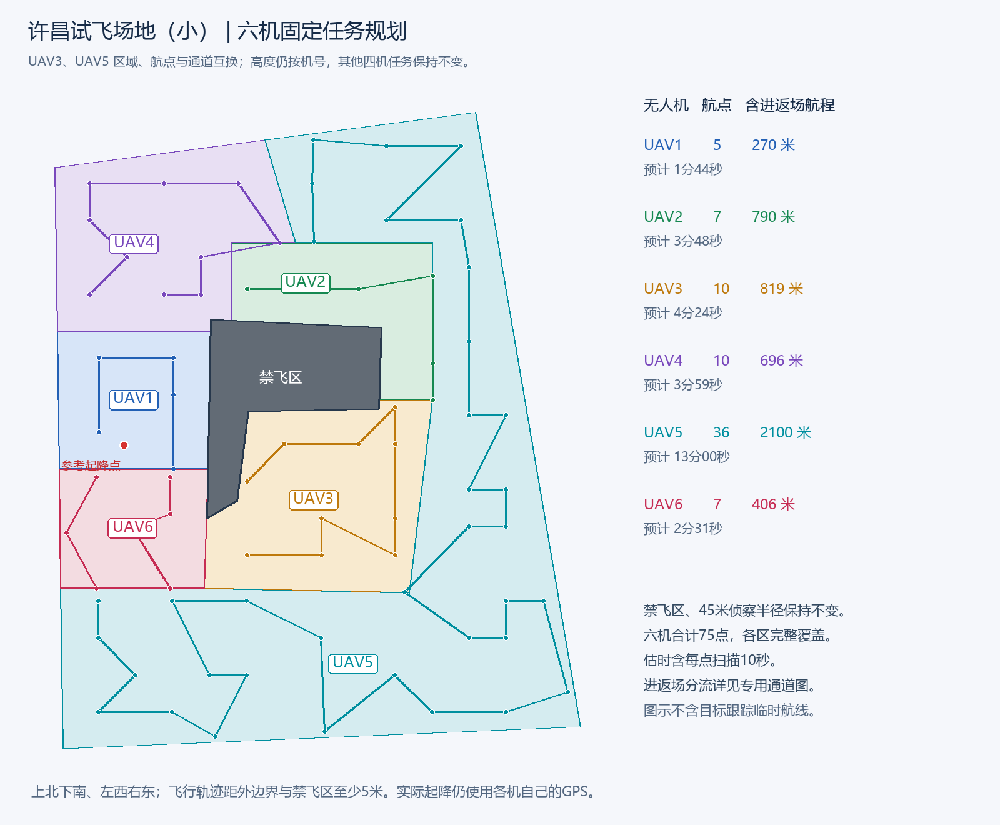
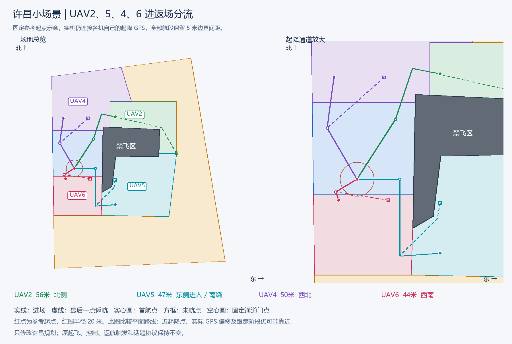
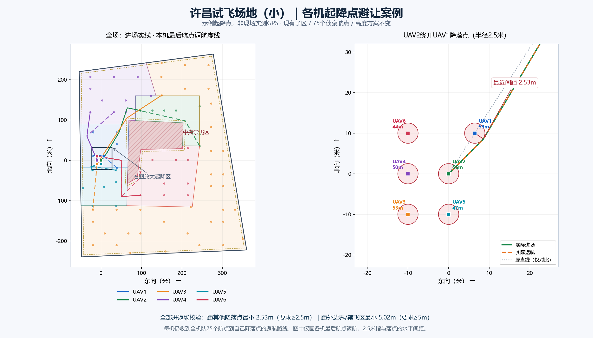

# 许昌试飞场地（小）固定方案

坐标基准为 WGS84 十进制度。下表按「纬度、经度」书写；机载外部程序 B 的航点话题仍按 `[经度, 纬度, 相对高度]` 发布。

外边界与固定起点保持原坐标，场地外边界按下表顺序闭合：

| 外边界点 | 纬度 | 经度 |
| --- | ---: | ---: |
| 1 | 34.136123 | 113.908559 |
| 2 | 34.136278 | 113.912981 |
| 3 | 34.140655 | 113.912085 |
| 4 | 34.140263 | 113.908491 |

固定起点：纬度 **34.138282**、经度 **113.909077**。

## 新禁止飞行区域

原矩形扣除区已删除，由以下六点依次闭合形成新的禁飞区。区内不侦察，侦察航段、进场和返航路线均不得穿越，且距其边界至少 5 米。

| 禁飞区角点 | 纬度 | 经度 |
| --- | ---: | ---: |
| 1 | 34.139176470619766 | 113.90981948390986 |
| 2 | 34.13911894613526 | 113.91127900740348 |
| 3 | 34.13854369913638 | 113.9112600525529 |
| 4 | 34.13852278098991 | 113.91014171636951 |
| 5 | 34.13789000461156 | 113.91004694211667 |
| 6 | 34.13776449468414 | 113.90978789249225 |

外边界面积约 175974.5 平方米，新禁飞区约 11285.6 平方米，剩余约 164688.9 平方米全部按侦察半径 **45 米**覆盖。航速 **5 米/秒**、每点扫描 **10 秒**。

## 当前六机分区（2026-10-14）

本轮将原 UAV5、UAV6 的完整子区域、航点及执行顺序互换，进返场通道随区域一起交换。UAV1～4 的子区域和航点不变。各机高度仍按机号选择，不随区域交换。

- UAV1 为西中部子区，5 个航点，位于 UAV4 南侧。
- UAV2 为东北部子区，7 个航点，保留原北侧进返场通道。
- UAV3 为东侧、南侧较大区域，36 个航点；包含此前从 UAV4 转交的东侧六点及补充覆盖点。
- UAV4 为北部西侧整块子区，10 个航点，使用西北通道。
- UAV5 接收原 UAV6 子区，10 个航点，使用东侧进入、南侧绕行通道。
- UAV6 接收原 UAV5 西南子区，7 个航点，使用西南通道。

六个子区均为单个连通多边形，无重叠，合并后恰好覆盖全部可侦察区域。原有形状约束、禁飞区及覆盖规则不变。交换按固定参考方案生成，重复生成不会再交换回来。



## 航点与进返场路线

| 无人机 | 航点数 | 子区面积（平方米） | 含进返场航程（米） | 估计执行时间 | 六机不同高度 |
| --- | ---: | ---: | ---: | ---: | ---: |
| UAV1 | 5 | 12895.6 | 270.2 | 1分44秒 | 59米 |
| UAV2 | 7 | 12679.1 | 789.8 | 3分48秒 | 56米 |
| UAV3 | 36 | 83978.1 | 2100.3 | 13分00秒 | 53米 |
| UAV4 | 10 | 22149.8 | 695.8 | 3分59秒 | 50米 |
| UAV5 | 10 | 22182.8 | 819.4 | 4分24秒 | 47米 |
| UAV6 | 7 | 10803.5 | 406.3 | 2分31秒 | 44米 |

共75个航点，含进返场总航程约5081.8米。估时按5米/秒、每点扫描10秒计算，不包括程序B发现目标后的临时跟踪耗时。固定范围限制下各机工作量不同，不保证六机等时。

所有侦察航点、连接航段、进场及返航路线距场地外边界、禁飞区边界至少5米。子区之间的分割线仅用于任务归属，不是额外禁飞边界。

UAV2、5、4、6的专用进返场通道与原几何保持一致，仅机号归属改变。固定参考起点下，剔除起点20米范围后，这四机进场与最终返航路线最小平面间距约13.09米。此结果只适用于已验证的参考布局，不是全程实时避碰保证。



实际分派仍采用每机本次开机记录的有效GPS作为自己的起降点，重接进返场路线并避让其他已连接飞机的降落点至少2.5米。每架接收机收到全部75个航点到自身降落点的返航路线。高度、降落点归属、一键起飞、返航触发、外部程序B及话题格式均不因本次交换改变。

全部高度档均可选择。“六机不同”高度为UAV1～6对应59、56、53、50、47、44米；“科目二高度”六机均为相对起飞点50米。本表和三维预览使用固定参考起点，实飞进返场使用各机本次开机记录。

## 固定规划文件

- 固定侦察方案：`competition_backend/competition_backend/xuchang_small_prepared.json`
- 固定进返场路线：`competition_backend/competition_backend/external_transit_prepared.json`
- 分区基准：`xuchang_small_partition_reference.json`
- 东侧六点转区基准：`xuchang_small_east_transfer_reference.json`

运行时读取固定方案，分派时按各机起降点重接；起飞后不自动重新规划。离线重新生成命令：

```powershell
python tools/prepare_xuchang_small_plan.py
python tools/prepare_transit_routes.py
python tools/build_plans_3d.py
```

[查看三维规划](competition_plans_3d.html) · [查看平面规划图](xuchang_small_plan.png)

## 开机起降点避让案例



图中为假设的示例GPS，不是实机数据。以固定参考起点为原点（北、西，米）：UAV1=(10,-6.4286)，UAV2=(0,0)，UAV3=(-10,10)，UAV4=(0,10)，UAV5=(-10,0)，UAV6=(10,10)。UAV1处于UAV2原进场连接直线上，实际规划绕开其降落点。

使用实际运行时函数检查全部6条进场路线及6×75条返航路线：到其他落点最小水平距离不少于2.5米，到外边界及禁飞区至少5米。2.5米是对其他降落点的距离，不代表任意时刻两架飞行中的飞机都有此间距。

[示例规划JSON](xuchang_boot_home_example.json)可导入[三维总览](competition_plans_3d.html)，仅供查看，不用于现场分派。程序B仍使用原有entry_path/return_paths话题。
